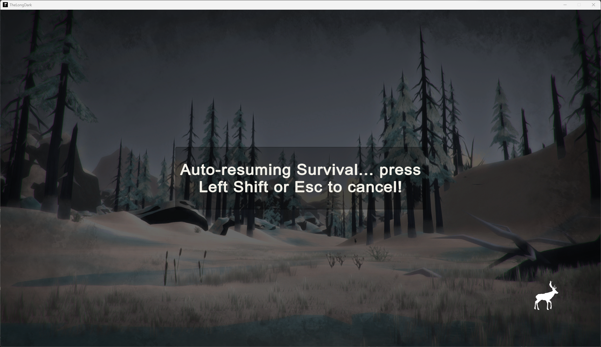

# AutoResumeSurvival

Does your game take forever to load into your Survival save? Do you wish you could start in a paused state so that you can take a moment to breathe before your character starts to freeze and starve again? Well, AutoResumeSurvival is here to help!

AutoResumeSurvival is a lightweight mod for The Long Dark that automatically navigates from game startup to the Survival mode menu, selects "RESUME", and presses Escape once your save finishes loading so that you start in a paused state.

## Features

- Automatic Main Menu to Survival Mode navigation.
- Automatic selection of RESUME.
- Dynamic readiness detection that waits for loading panels and screen fade-ins to finish before sending Escape.
- On-screen prompt displaying how to cancel auto-resume while active.

## Requirements

- The Long Dark (tested on v2.60)
- MelonLoader v0.7.2

## Installation

1. Install MelonLoader v0.7.2 for The Long Dark if you have not already.
2. Place `AutoResumeSurvival.dll` into your game's `Mods` folder (for example, `E:\SteamLibrary\steamapps\common\TheLongDark\Mods`).
3. Launch the game.

## Usage

When the game starts, AutoResumeSurvival displays an on-screen prompt indicating that auto-resume is active and how to cancel.

- Let it run to jump straight into your Survival save and pause automatically once the world finishes loading.
- Press Left Shift or Esc while the message is displayed to cancel auto-resume and take manual control.

## AI Disclaimer

AI tools were consulted during the development of this mod as part of my learning process for exploring The Long Dark's IL2CPP APIs, Harmony patching, and troubleshooting. All code was tested and verified in-game.

## License

This project is open source and available under the [MIT License](LICENSE).
